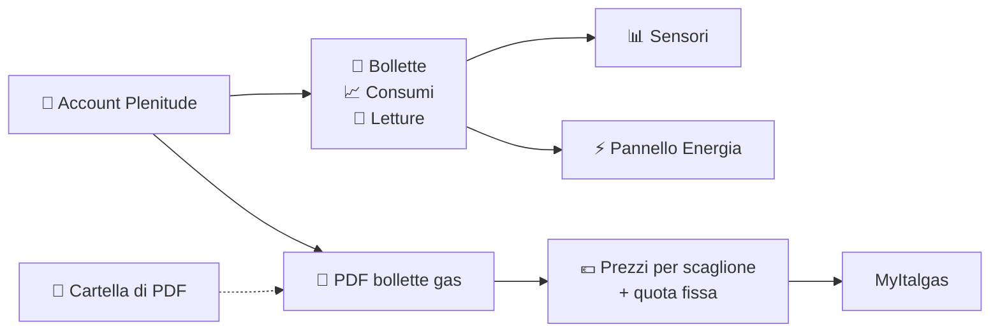

<h1 align="center">Plenitude per Home Assistant</h1>

<p align="center">
  <b>Integrazione non ufficiale</b> che porta in Home Assistant bollette, consumi e letture<br>
  di luce e gas del <b>tuo</b> account Eni Plenitude, anche nel pannello Energia.
</p>

<p align="center">
  <a href="https://github.com/LucaTomei/ha-plenitude/releases"></a>
  <a href="https://github.com/LucaTomei/ha-plenitude/actions/workflows/validazione.yml"></a>
  <a href="https://github.com/hacs/integration"></a>
  
  <a href="LICENSE"></a>
</p>

> [!CAUTION]
> **Progetto personale e non ufficiale.** Non è affiliato, collegato, sponsorizzato,
> approvato né supportato da Eni Plenitude S.p.A., da Eni S.p.A. o da altre società del
> gruppo. Per qualsiasi questione sulla tua fornitura rivolgiti a Plenitude; per problemi
> di questa integrazione apri una issue qui. Vedi le [note legali](#%EF%B8%8F-note-legali).

## 🚀 Installazione in 3 click

| | Click | Cosa succede |
|:---:|:---:|---|
| **1** | [](https://my.home-assistant.io/redirect/hacs_repository/?owner=LucaTomei&repository=ha-plenitude&category=integration) | Si apre HACS nel tuo Home Assistant: conferma l'aggiunta del repository, poi **Scarica**. |
| **2** | [](https://my.home-assistant.io/redirect/server_controls/) | **Riavvia** Home Assistant, così carica l'integrazione appena scaricata. |
| **3** | [](https://my.home-assistant.io/redirect/config_flow_start/?domain=plenitude) | Si apre la configurazione di **Plenitude**: scegli *Account Plenitude* e accedi. |

> [!WARNING]
> Il pulsante **3** funziona solo dopo i passi 1 e 2. Se Home Assistant risponde
> *"Questa integrazione non supporta la configurazione tramite l'interfaccia utente"*,
> l'integrazione non è ancora scaricata o Home Assistant non è stato riavviato.

<sub>I pulsanti usano <a href="https://my.home-assistant.io">My Home Assistant</a>: la prima volta ti chiede l'indirizzo del tuo Home Assistant.</sub>

---

## ✨ In breve

<table>
  <tr>
    <td width="50%" valign="top">
      <h3>🧾 Bollette</h3>
      Importo, emissione e scadenza dell'ultima bolletta, stato del pagamento, totale e
      numero di bollette ancora <b>da pagare</b>, per luce e gas.
    </td>
    <td width="50%" valign="top">
      <h3>📈 Consumi</h3>
      Consumo dell'ultimo mese e degli ultimi 12 mesi, in kWh per la luce (anche per fascia
      <b>F1/F2/F3</b>) e in Smc per il gas.
    </td>
  </tr>
  <tr>
    <td width="50%" valign="top">
      <h3>⚡ Pannello Energia</h3>
      Storico dei consumi mensili <b>dall'attivazione della fornitura</b>, pronto da
      aggiungere come consumo dalla rete (luce) e consumo di gas.
    </td>
    <td width="50%" valign="top">
      <h3>🔥 Gas e MyItalgas</h3>
      Lettura del contatore, prossima autolettura e <b>prezzi reali</b> per scaglione e
      quota fissa, letti dalle bollette e passati a
      <a href="https://github.com/LucaTomei/ha-myitalgas">MyItalgas</a>.
    </td>
  </tr>
  <tr>
    <td width="50%" valign="top">
      <h3>🔐 Accesso sicuro</h3>
      Email, password e codice di verifica via email, come nell'app. La password
      <b>non viene salvata</b>; la sessione dura un anno e sopravvive ai riavvii.
    </td>
    <td width="50%" valign="top">
      <h3>🔄 Tutto automatico</h3>
      Nuove bollette, nuove forniture e PDF scaricati da soli. Se la sessione scade,
      Home Assistant ti chiede di <b>riautenticarti</b>.
    </td>
  </tr>
</table>



> [!TIP]
> Non vuoi collegare l'account? Puoi anche solo mettere le bollette gas in PDF in una
> cartella: vedi [Bollette da cartella](#-bollette-da-cartella).

## 📚 Indice

- [Installazione in 3 click](#-installazione-in-3-click)
- [Requisiti](#-requisiti)
- [Installazione](#-installazione)
- [Configurazione](#%EF%B8%8F-configurazione)
- [Entità](#-entità)
- [Pannello Energia](#-pannello-energia)
- [Collegamento con MyItalgas](#-collegamento-con-myitalgas)
- [Bollette da cartella](#-bollette-da-cartella)
- [Come funziona l'accesso](#-come-funziona-laccesso)
- [Privacy](#%EF%B8%8F-privacy)
- [Risoluzione dei problemi](#-risoluzione-dei-problemi)
- [Sviluppo](#%EF%B8%8F-sviluppo)
- [Note legali](#%EF%B8%8F-note-legali)

## 📋 Requisiti

- **Home Assistant 2025.11** o successivo.
- Un account **Plenitude** (lo stesso dell'app), oppure le bollette gas in PDF.
- Facoltativo: l'integrazione **MyItalgas** configurata sulla stessa fornitura gas.

## 📦 Installazione

### HACS (consigliata)

Il modo più rapido è l'[installazione in 3 click](#-installazione-in-3-click). Senza i
pulsanti:

1. HACS → tre puntini in alto a destra → **Repository personalizzati**.
2. Repository `https://github.com/LucaTomei/ha-plenitude`, tipo **Integrazione**, **Aggiungi**.
3. Cerca **Plenitude**, aprilo, **Scarica**, poi riavvia Home Assistant.

### Manuale

Scarica `plenitude.zip` dall'[ultima release](https://github.com/LucaTomei/ha-plenitude/releases/latest),
estrailo in `config/custom_components/plenitude` e riavvia Home Assistant.

## ⚙️ Configurazione

Dopo installazione e riavvio:
[](https://my.home-assistant.io/redirect/config_flow_start/?domain=plenitude)

Oppure **Impostazioni → Dispositivi e servizi → + Aggiungi integrazione → Plenitude**, poi
scegli **Account Plenitude**:

| Passo | Cosa fare |
|:---:|---|
| 1️⃣ | Inserisci **email e password** dell'app Plenitude. |
| 2️⃣ | Inserisci il **codice di 6 cifre** che Plenitude ti invia per email. Non arriva? Spunta *Invia un nuovo codice*. |
| 3️⃣ | Scegli **ogni quante ore** aggiornare e, se vuoi, la **fornitura MyItalgas** da aggiornare con i prezzi. |

Fatto: dopo pochi secondi compaiono i dispositivi **Plenitude Luce** e **Plenitude Gas**;
i PDF delle bollette gas si scaricano in background nei minuti successivi.

> [!NOTE]
> Puoi aggiungere più account Plenitude. La password serve solo per l'accesso e non viene
> salvata.

Le opzioni si cambiano in seguito da **Configura**:

| Opzione | Descrizione |
|---|---|
| Intervallo di aggiornamento | Ogni quante ore aggiornare i dati (1–168, predefinito 12). |
| Fornitura gas MyItalgas | Facoltativa: la fornitura MyItalgas a cui inviare i prezzi del gas. |
| Conto gas collegato a MyItalgas | Compare solo se l'account ha più forniture gas. |
| Cartella delle bollette | Solo per le bollette da cartella. |

## 📊 Entità

Con l'account trovi un dispositivo **Plenitude** per l'account e uno per ogni fornitura
(**Plenitude Luce**, **Plenitude Gas**).

| Entità | 💡 Luce | 🔥 Gas | Descrizione |
|---|:---:|:---:|---|
| Importo ultima bolletta | ✅ | ✅ | € dell'ultima bolletta; negli attributi numero, periodo, consumo, scadenza, stato e metodo di pagamento |
| Scadenza ultima bolletta | ✅ | ✅ | Data di scadenza |
| Emissione ultima bolletta | ✅ | ✅ | Data di emissione |
| Da pagare | ✅ | ✅ | Totale ancora da pagare; negli attributi le bollette e la prossima scadenza |
| Bollette da pagare | ✅ | ✅ | Quante bollette hanno un importo da pagare |
| Spesa ultimo mese | ✅ | ✅ | € dell'ultimo mese fatturato; negli attributi la spesa di ogni mese degli ultimi 12 |
| Consumo ultimo mese | ✅ | ✅ | kWh o Smc dell'ultimo mese completo; per la luce anche le fasce |
| Consumo ultimi 12 mesi | ✅ | ✅ | kWh o Smc degli ultimi 12 mesi completi |
| Prezzo medio | ✅ | ✅ | €/kWh o €/m³ effettivi dell'ultima bolletta: importo totale ÷ consumo del periodo |
| Prezzo energia | ✅ | | €/kWh dei consumi con accise e IVA, senza quota fissa, quota potenza e canone |
| PUN | ✅ | | PUN applicato in bolletta nell'ultimo mese fatturato (€/kWh), con lo storico dei mesi, lo spread e il dispacciamento |
| Indice gas (PSV) | | ✅ | Indice del gas applicato in bolletta nell'ultimo mese fatturato (€/Smc), con lo storico dei mesi e lo spread |
| Offerta | ✅ | ✅ | Nome dell'offerta; negli attributi tipo, mercato e validità delle condizioni economiche (anche se scadute) |
| Prezzo gas | | ✅ | €/m³ del gas nello scaglione raggiunto quest'anno, IVA inclusa, senza quote fisse |
| Consumo ultima bolletta | ✅ | ✅ | kWh o Smc fatturati nell'ultima bolletta |
| Consumo annuo | ✅ | ✅ | kWh o Smc dell'ultimo anno, come riportato nell'ultima bolletta |
| Lettura contatore | ✅ | ✅ | Ultima lettura (kWh, anche per fascia F1/F2/F3, oppure m³), con la data |
| Potenza impegnata | ✅ | | kW del contratto; negli attributi la potenza disponibile e la quota potenza |
| Prossima autolettura | | ✅ | Inizio della prossima finestra per l'autolettura |
| Bollette lette | ✅ | ✅ | Diagnostica: bollette PDF lette (per il gas anche i periodi tariffari ricavati) |
| Spesa totale ultimo mese | | | Sul dispositivo dell'account: luce + gas dell'ultimo mese fatturato per entrambi, con i 12 mesi precedenti |
| Ultimo aggiornamento | | | Diagnostica, sul dispositivo dell'account: ultima lettura riuscita |
| Scarica le bollette | | | Pulsante, sul dispositivo dell'account: rilegge subito l'account e scarica le bollette mancanti |

<details>
<summary><b>Esempio di automazione: avviso per una bolletta da pagare</b></summary>

```yaml
automation:
  - alias: "Plenitude: bolletta luce da pagare"
    triggers:
      - trigger: numeric_state
        entity_id: sensor.plenitude_luce_da_pagare
        above: 0
    actions:
      - action: notify.notify
        data:
          title: "Bolletta luce da pagare"
          message: >
            {{ states('sensor.plenitude_luce_da_pagare') }} € entro il
            {{ state_attr('sensor.plenitude_luce_da_pagare', 'prossima_scadenza') }}
```

Gli identificativi delle entità dipendono dalla lingua di Home Assistant: controllali in
**Impostazioni → Dispositivi e servizi → Plenitude**.

</details>

<details>
<summary><b>Entità con le bollette da cartella</b></summary>

*Importo*, *Scadenza* e *Consumo* dell'ultima bolletta, *Consumo annuo*, *Bollette lette*
e *Ultimo aggiornamento*.

</details>

## ⚡ Pannello Energia

Con l'account, lo storico dei consumi mensili di ogni fornitura viene importato come
statistica esterna, da aggiungere in **Impostazioni → Pannelli → Energia**:

| Statistica | Unità | Dove aggiungerla |
|---|:---:|---|
| `plenitude:consumo_luce_<conto>` | kWh | **Rete elettrica → Consumo dalla rete** |
| `plenitude:consumo_gas_<conto>` | m³ | **Consumo di gas** |

I valori sono **mensili** (registrati all'inizio di ogni mese, con lo storico
dall'attivazione della fornitura): guardali per mese o per anno. Il mese in corso e i
due precedenti vengono aggiornati a ogni lettura, così le stime vengono sostituite dai
consumi reali.

### 📅 Spesa di ogni mese

Le bollette coprono di solito due mesi: l'integrazione le divide mese per mese. A ogni
mese va la sua parte fissa (gas: quota fissa del mese; luce: quota fissa, quota potenza e
canone RAI) e il resto dell'importo è diviso in proporzione ai consumi di ciascun mese.
La somma dei mesi è sempre uguale a quanto hai pagato.

Oltre ai sensori *Spesa ultimo mese* e *Spesa totale ultimo mese*, le spese sono
importate come statistiche in euro, con lo storico di tutte le bollette scaricate:

| Statistica | Contenuto |
|---|---|
| `plenitude:spesa_luce_<conto>` | Spesa della luce |
| `plenitude:spesa_gas_<conto>` | Spesa del gas |
| `plenitude:spesa_totale_<account>` | Luce + gas, nei mesi già fatturati per entrambi |

<details>
<summary><b>Scheda con il grafico della spesa mese per mese</b></summary>

Aggiungi una scheda manuale alla plancia (sostituisci gli identificativi con i tuoi, che
trovi in **Strumenti per sviluppatori → Statistiche** cercando "plenitude"):

```yaml
type: statistics-graph
title: Spesa Plenitude
chart_type: bar
period: month
days_to_show: 365
stat_types:
  - change
entities:
  - plenitude:spesa_luce_<conto>
  - plenitude:spesa_gas_<conto>
```

</details>

### 💶 Costi nel pannello Energia

Nella configurazione di ogni sorgente scegli **"Utilizza un'entità con il prezzo corrente"**:

| Sorgente | Entità da scegliere | Perché |
|---|---|---|
| ⚡ Luce | **Plenitude Luce · Prezzo medio** (€/kWh) | Importo dell'ultima bolletta diviso per i kWh fatturati: comprende energia, trasporto, oneri, quote fisse, imposte e IVA, quindi il totale nel pannello si avvicina alla bolletta. Se vuoi vedere solo il costo dei consumi usa invece **Prezzo energia**. |
| 🔥 Gas | **Plenitude Gas · Prezzo gas** (€/m³) | Prezzo reale del gas per lo scaglione raggiunto quest'anno. Il *prezzo medio* del gas non è adatto: d'estate le quote fisse lo gonfiano. |

> [!NOTE]
> Il solo PUN (prezzo all'ingrosso) copre circa metà del costo reale della luce: per
> avere nel pannello la spesa vera usa il *Prezzo medio* di Plenitude. Per il gas il
> pannello non può aggiungere le quote fisse mensili (circa 17 € al mese, IVA inclusa):
> il costo mostrato è quello dei consumi.

> [!IMPORTANT]
> Per il gas puoi usare in alternativa il sensore **Lettura contatore** (m³, totale
> crescente): scegli **uno solo** dei due, altrimenti i consumi vengono contati due volte.
> Se hai MyItalgas, i suoi consumi giornalieri sono più precisi: in quel caso usa
> MyItalgas per il gas e Plenitude per i prezzi.

## 🔗 Collegamento con MyItalgas

Se scegli una **fornitura MyItalgas** nelle opzioni, a ogni aggiornamento Plenitude crea
o aggiorna in MyItalgas i **periodi tariffari** del gas: un periodo per ogni mese presente
nelle bollette, con i tre prezzi per scaglione e la quota fissa, IVA inclusa. Così il
sensore *Costo stimato* e la statistica dei costi di MyItalgas usano i prezzi reali.

<details>
<summary><b>Come vengono calcolati i prezzi</b></summary>

- Le bollette riportano le tariffe per lo **scaglione annuo di consumo** raggiunto in ogni
  mese (fino a 120, 121–480, oltre 480 Smc): quel prezzo è preso esattamente dalla bolletta.
- Per gli scaglioni non raggiunti si usa il valore noto più vicino.
- Oltre 480 Smc/anno l'IVA passa dal 10% al 22%.
- Quando una bolletta rifattura mesi già fatturati (conguaglio con le letture reali),
  valgono le voci della bolletta più recente.
- Vengono lette sia le bollette attuali sia quelle nel formato usato fino all'inizio del 2025.

Con l'account, i PDF delle ultime 24 bollette gas vengono scaricati una sola volta in
`config/plenitude/archivio/<conto>/` e letti da lì.

</details>

## 📁 Bollette da cartella

Senza account, le bollette gas in PDF vengono lette da una cartella: scegli **Cartella di
PDF** quando aggiungi l'integrazione. La cartella predefinita è `config/plenitude/bollette`
e viene creata da sola al primo avvio.

- **A mano:** copia nella cartella i PDF delle bollette gas scaricati dall'area clienti
  Plenitude. Più ne metti, più indietro va lo storico dei prezzi. Puoi rimuoverli dopo
  l'importazione: i periodi tariffari restano in MyItalgas.
- **In automatico dalle email:** se ricevi le bollette via email con il PDF allegato, usa
  l'integrazione ufficiale **IMAP** di Home Assistant per salvare l'allegato nella cartella
  appena arriva (azione *Imap: scarica allegato* / `imap.download`).

## 🔐 Come funziona l'accesso

L'integrazione usa gli stessi servizi dell'app Plenitude. All'accesso con email, password
e codice di verifica si ottiene una sessione che dura **un anno**, salvata nella
configurazione di Home Assistant: dopo un riavvio non serve rifare nulla.

Se la sessione scade o viene revocata (ad esempio cambiando password), Home Assistant
mostra la richiesta di **riautenticazione** in *Impostazioni → Dispositivi e servizi*:
basta inserire di nuovo password e codice. Se Plenitude è momentaneamente irraggiungibile,
l'integrazione riprova da sola senza chiederti nulla.

## 🛡️ Privacy

- I dati restano sul tuo Home Assistant e vengono richiesti solo a Plenitude.
- La password non viene salvata: si conserva solo la sessione dell'account.
- I PDF scaricati restano in `config/plenitude/archivio/`; puoi cancellarli quando vuoi
  (verranno riscaricati solo quelli che servono).
- La **diagnostica** scaricabile e i log non contengono credenziali, sessione, codici dei
  conti, PDR, POD né indirizzi.

## 🧰 Risoluzione dei problemi

| Problema | Soluzione |
|---|---|
| *"Questa integrazione non supporta la configurazione tramite l'interfaccia utente"* | L'integrazione non è installata o Home Assistant non è stato riavviato: fai i passi 1 e 2 dell'[installazione](#-installazione-in-3-click). |
| *Email o password errate* | Usa le stesse credenziali dell'app Plenitude. |
| Il codice non arriva | Controlla lo spam, poi spunta *Invia un nuovo codice*. |
| *La verifica è scaduta* | Chiudi la finestra e ricomincia l'aggiunta dell'integrazione. |
| *Account bloccato temporaneamente* | Troppi tentativi: riprova dopo qualche minuto. |
| Richiesta di riautenticazione | La sessione è scaduta o revocata: inserisci di nuovo password e codice. |
| L'integrazione va in *riprova* | Plenitude non raggiungibile: riprova da sola più tardi. |
| *Bollette lette* resta a 0 | I PDF sono ancora in download (pochi minuti) o non sono bollette gas leggibili. |
| Manca una bolletta o un prezzo | Premi **Scarica le bollette** sul dispositivo *Plenitude*: rilegge l'account e riprova i download. |
| Una fornitura non c'è più | Il suo dispositivo diventa non disponibile: puoi eliminarlo dalla pagina del dispositivo. |
| I prezzi non arrivano in MyItalgas | Verifica la fornitura MyItalgas nelle opzioni e che MyItalgas sia installato. |

Per il debug: **Impostazioni → Dispositivi e servizi → Plenitude → ⋮ → Abilita il debug**.
Per segnalare un problema apri una
[issue](https://github.com/LucaTomei/ha-plenitude/issues) allegando la diagnostica
(è già priva di dati personali).

## 🛠️ Sviluppo

<details>
<summary><b>Test e rilascio</b></summary>

```bash
python3.13 -m venv .venv && source .venv/bin/activate
pip install -r requirements_test.txt
ruff check . && ruff format --check .
pytest
```

I test girano su un account Plenitude simulato e su bollette di esempio anonimizzate
(nessun dato personale, nessun accesso reale a Plenitude), sia sull'ultima versione di
Home Assistant sia sulla 2025.11.

Per pubblicare una versione: aggiungi la voce in `CHANGELOG.md` e lancia
`scripts/rilascia.sh X.Y.Z`.

</details>

## ⚖️ Note legali

- **Progetto indipendente.** Questa integrazione è un progetto personale, sviluppato
  nel tempo libero e distribuito gratuitamente. Non è affiliata, collegata, sponsorizzata,
  approvata né supportata da Eni Plenitude S.p.A., da Eni S.p.A. o da altre società del
  gruppo, e non ne rappresenta in alcun modo la posizione.
- **Marchi.** "Eni", "Plenitude", i relativi loghi e gli altri marchi citati appartengono
  ai rispettivi titolari. Sono usati solo per indicare con quale servizio funziona
  l'integrazione, senza alcuna pretesa di titolarità o di approvazione.
- **Uso dei dati.** L'integrazione accede soltanto all'account di chi la configura, con le
  sue credenziali, agli stessi dati che quella persona vede nell'app Plenitude, e li
  conserva solo nella sua installazione di Home Assistant. Ogni utente è responsabile
  dell'uso che ne fa e del rispetto delle condizioni del servizio Plenitude.
- **Nessuna garanzia.** Il software è fornito "così com'è", senza garanzie, come previsto
  dalla licenza [MIT](LICENSE). I dati mostrati sono indicativi: per importi, scadenze e
  consumi fanno fede le bollette e l'area clienti Plenitude.
- **Richieste dei titolari.** Se sei titolare di un diritto e ritieni che qualcosa in
  questo repository debba essere modificato o rimosso, apri una issue: la richiesta verrà
  valutata e gestita prontamente.
